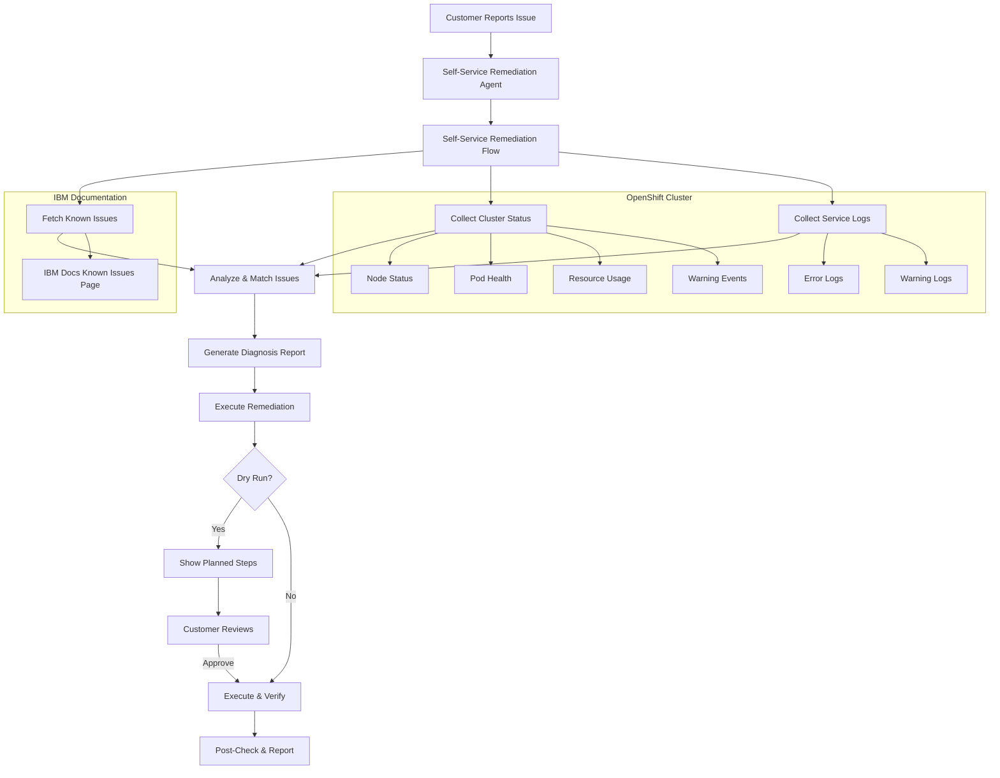
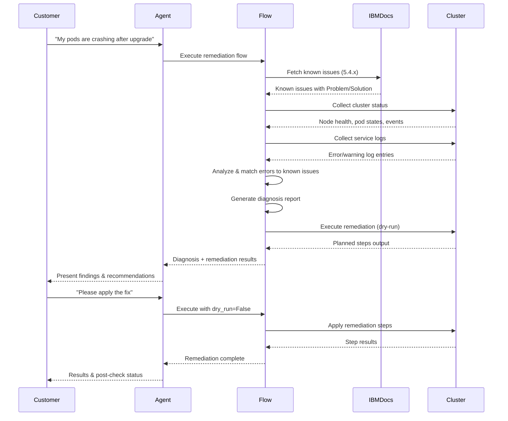

# Self-Service Remediation Agent for watsonx Orchestrate

An intelligent agent that automatically diagnoses and remediates known issues on watsonx Orchestrate deployments running on Red Hat OpenShift clusters.

## Overview

When a watsonx Orchestrate customer encounters an issue, this agent:
1. **Retrieves** documented known issues from IBM documentation for the release
2. **Collects** cluster status, pod health, and service logs from the OpenShift cluster
3. **Analyzes** errors and matches them against known issues
4. **Executes** automated remediation steps (with dry-run safety by default)

## Architecture



## Workflow Sequence



## Project Structure

```
self_service_remediation/
├── __init__.py                           # Package initialization
├── flow_main.py                          # Programmatic testing script (WXO flow engine)
├── run_remediation.py                    # Standalone CLI runner (no WXO engine required)
├── import-all.sh                         # CLI import script
├── requirements.txt                      # Python dependencies
├── README.md                             # This file
├── tools/
│   ├── __init__.py
│   ├── fetch_known_issues.py             # Scrape IBM docs for known issues
│   ├── collect_cluster_status.py         # Gather OpenShift cluster health
│   ├── collect_service_logs.py           # Collect service pod logs
│   ├── analyze_and_match.py             # Match errors to known issues
│   ├── execute_remediation.py           # Execute solution steps safely
│   └── remediation_flow.py             # Main orchestrating flow
├── agents/
│   └── self_service_remediation_agent.yaml  # Agent configuration
└── generated/
    └── remediation_flow.json            # Compiled flow spec (auto-generated)
```

## Tools

| Tool | Purpose |
|------|---------|
| `fetch_known_issues` | Fetches and parses known issues from IBM documentation for a specific release |
| `collect_cluster_status` | Collects OpenShift cluster node status, unhealthy pods, resource pressure, and events |
| `collect_service_logs` | Retrieves error/warning logs from watsonx Orchestrate service pods |
| `analyze_and_match_issues` | Correlates cluster errors with documented known issues using keyword matching |
| `execute_remediation` | Executes solution steps from matched issues with safety controls |
| `generate_diagnosis_report` | Creates a comprehensive diagnosis summary combining all data |

## Prerequisites

1. **OpenShift CLI (`oc`)** installed and configured with cluster access
2. **watsonx Orchestrate ADK** installed (`pip install ibm-watsonx-orchestrate`)
3. **Cluster access** with permissions to:
   - Read pod/node status (`oc get pods`, `oc get nodes`)
   - Read pod logs (`oc logs`)
   - Read events (`oc get events`)
   - Restart deployments (`oc rollout restart`) - for write operations
   - Scale deployments (`oc scale`) - for write operations

## Deployment

### Import into watsonx Orchestrate

```bash
# Ensure CLI is authenticated
orchestrate env activate local  # or your target environment

# Run the import script
chmod +x import-all.sh
./import-all.sh
```

### Manual Import Steps

```bash
# 1. Import Python tools
orchestrate tools import -k python \
  -p tools \
  -f tools/fetch_known_issues.py \
  -r requirements.txt

orchestrate tools import -k python \
  -p tools \
  -f tools/collect_cluster_status.py \
  -r requirements.txt

orchestrate tools import -k python \
  -p tools \
  -f tools/collect_service_logs.py \
  -r requirements.txt

orchestrate tools import -k python \
  -p tools \
  -f tools/analyze_and_match.py \
  -r requirements.txt

orchestrate tools import -k python \
  -p tools \
  -f tools/execute_remediation.py \
  -r requirements.txt

# 2. Import the flow
orchestrate tools import -k flow -f tools/remediation_flow.py

# 3. Import the agent
orchestrate agents import -f agents/self_service_remediation_agent.yaml
```

## Usage

### Chat Interface

```
orchestrate chat start
```

Select the `self_service_remediation_agent` and describe your issue:

**Example interactions:**
- "My watsonx Orchestrate pods are stuck in CrashLoopBackOff after upgrading to 5.4"
- "Elasticsearch cluster health is RED and search is not working"
- "Certificate errors in service communication logs"
- "RabbitMQ queues are growing, messages are not being processed"
- "PVC is stuck in Pending state, new pods cannot start"

### Standalone CLI Runner

[`run_remediation.py`](run_remediation.py) calls every pipeline step directly without the WXO flow engine. Use it for local debugging, one-off ad-hoc remediation, or testing without a deployed watsonx Orchestrate environment.

```bash
# Dry-run (default) — show what would be executed without applying any changes
python3 self_service_remediation/run_remediation.py \
    --issue "Pods are stuck in CrashLoopBackOff after the recent upgrade" \
    --namespace cpd \
    --release 5.4.x

# Live execution — sends real oc commands to the cluster
python3 self_service_remediation/run_remediation.py \
    --issue "Elasticsearch cluster health is RED" \
    --no-dry-run

# Save the full result as JSON for further processing
python3 self_service_remediation/run_remediation.py \
    --output-json result.json
```

**CLI arguments:**

| Argument | Default | Description |
|----------|---------|-------------|
| `--issue` | `"Pods are stuck in CrashLoopBackOff…"` | User-reported issue description |
| `--namespace` | `cpd` | OpenShift namespace to inspect |
| `--release` | `5.4.x` | watsonx Orchestrate release version |
| `--dry-run` | *(default)* | Preview commands without executing them |
| `--no-dry-run` | — | Apply remediation commands for real |
| `--output-json FILE` | — | Write the final result as JSON to a file |

The script prints a step-by-step progress report and exits with the combined result dictionary (same shape as the WXO flow output).

### Programmatic Testing (WXO flow engine)

```bash
python -m self_service_remediation.flow_main
```

## Safety Features

1. **Dry-run by default**: All remediation runs in preview mode unless explicitly approved
2. **Command safety filter**: Only read commands and known-safe write commands are auto-executed
3. **Blocked commands**: Potentially destructive operations require manual execution
4. **Post-checks**: After remediation, verifies component health
5. **Full audit trail**: Every step is logged with its command, status, and output

## Configuration

| Parameter | Default | Description |
|-----------|---------|-------------|
| `namespace` | `cpd` | OpenShift namespace for watsonx Orchestrate |
| `release_version` | `5.4.x` | IBM Software Hub release version |
| `dry_run` | `true` | Safety mode - preview without executing |
| `since_minutes` | `60` | How far back to collect logs |
| `service_filter` | `""` | Filter logs to specific services |

## Known Issue Sources

The agent fetches known issues from:
- `https://www.ibm.com/docs/en/software-hub/{version}?topic=issues-watsonx-orchestrate`

If the documentation page is unavailable, a fallback set of common known issues is used.

---

*Made with Bob*
