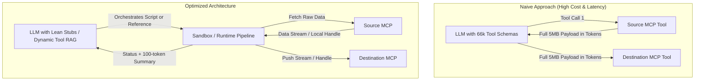

# Optimizing Model Context Protocol (MCP): Resolving Schema Bloat & Data Chaining

Modern autonomous agents face two primary cost and reliability bottlenecks when integrating with tools via the Model Context Protocol (MCP):

1. **Tool Schema Bloat (Upfront Token Overhead):** Eagerly loading extensive tool schemas into context consumes tens of thousands of tokens per turn before user interaction starts.
2. **Intermediate Data Chaining (Payload Round-Tripping):** Using the LLM as an intermediary data pipe to ferry raw output between tools adds latency, multiplies token costs, and introduces data corruption/hallucination risks.

---

## 1. Architectural Overview



---

## 2. Resolving Tool Schema Bloat

### A. Dynamic Tool Retrieval (Tool RAG / Just-In-Time Loading)
* **Metadata Indexing:** Embed tool names, capability descriptions, and domain tags in a lightweight local vector store or BM25 index.
* **Just-In-Time Injection:** Retrieve only the top 3–5 candidate tools relevant to the current user prompt or conversational turn, injecting full JSON schemas only when needed.
* **Tool Discovery Meta-Tool:** Expose a minimal discovery tool (e.g., `search_available_tools(query: str)`) allowing the agent to dynamically look up and bind tools at runtime.

### B. Two-Phase Schema Resolution (Stubs vs. Full Definitions)
* **Phase 1 (Lightweight Stubs):** Expose compact tool signatures in system instructions (consuming ~10–20 tokens each instead of 500–1,500 tokens per full JSON Schema).
* **Phase 2 (On-Demand Schema Expansion):** When the model selects a tool, it calls `describe_tool(tool_name: "jira_create_issue")` to fetch parameter requirements immediately prior to execution.

### C. Hierarchical Router-Worker Architecture
* **Triage / Orchestrator Agent:** Operates with a minimal system context and no direct tool attachments except subagent dispatchers.
* **Specialized Domain Subagents:** Worker agents are scoped to specific domains (e.g., *GitHub Agent*, *Salesforce Agent*, *Document Extraction Agent*) with narrow, dedicated toolsets. Context bloat remains isolated to short-lived subagent sessions.

### D. Server-Level Filtering & Dynamic Scoping
* Configure client-side white-lists and intent-based capability tags to load only relevant MCP server modules per session or workspace.

---

## 3. Resolving Intermediate Data Round-Tripping (The Chaining Problem)

### A. Pass-by-Reference / Claim-Check Pattern
Instead of passing multi-megabyte payloads through LLM tokens:
1. **Opaque Object Handles:** The source tool stores raw data in an ephemeral blob store, local file system, or memory cache, returning a handle URI (e.g., `urn:mcp:handle:doc_98124`).
2. **Metadata Envelopes:** The tool returns a lightweight confirmation and preview to the model:
   ```json
   {
     "status": "success",
     "handle": "urn:mcp:handle:doc_98124",
     "metadata": {
       "filename": "quarterly_report.pdf",
       "row_count": 450,
       "size_bytes": 1048576
     },
     "preview": "Executive Summary: Q3 revenue exceeded projections..."
   }
   ```
3. **Handle Consumption:** Downstream tools accept `source_handle: "urn:mcp:handle:doc_98124"` directly and stream data out-of-band across services without routing raw bytes through LLM context.

### B. Code Execution as the Orchestration Layer ("Code-as-Tools")
Instead of multi-turn conversational tool calling:
* Provide a sandboxed execution environment (e.g., Python / Bash runtime) where MCP tools are exposed as native libraries or SDK clients.
* The model writes and executes a single orchestration script:
  ```python
  # The LLM generates code; the runtime handles data piping directly
  raw_doc = sharepoint_client.download("quarterly_report.pdf")
  parsed = doc_parser.extract_tables(raw_doc)
  slack_client.post_summary(channel="#sales-ops", data=parsed)
  ```
* **Advantages:** Zero token overhead for intermediate payloads, native error handling (try/catch blocks), reduced network round-trips, and zero risk of hallucinating data transformations.

### C. Server-Side Composite Workflows
* For deterministic sequences (*Fetch document $\rightarrow$ Parse $\rightarrow$ Format $\rightarrow$ Upload*), encapsulate the pipeline into a single high-level composite tool on the MCP server.
* The agent invokes the flow with intent parameters, offloading byte-level piping to the host runtime.

---

## 4. Pattern Comparison Matrix

| Dimension | Naive MCP Pattern | Optimized Pattern | Impact |
| :--- | :--- | :--- | :--- |
| **Startup Overhead** | All schemas loaded eagerly (50k–100k+ tokens) | Dynamic Tool RAG & Lightweight Stubs | **90–95% reduction** in baseline startup token usage |
| **Data Transfer** | Full raw payload passes through LLM context | Pass-by-Reference (Handles) / Sandboxed Code | **Eliminates token consumption** on intermediate payloads |
| **Execution Latency** | Sequential LLM round trips for each data hop | Direct out-of-band streaming / Single code run | **Dramatically lower response latency** |
| **Reliability & Accuracy** | Vulnerable to context window limits & data hallucination | Deterministic piping and runtime error handling | **Zero data mangling** across transformation steps |
