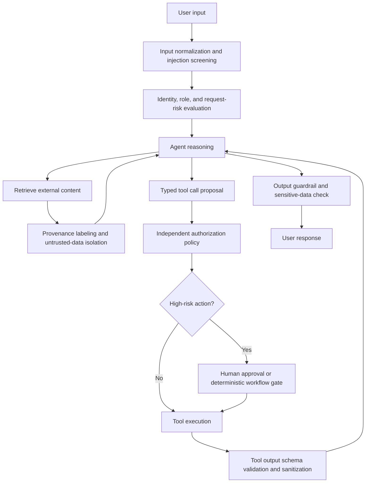

# Prompt-injection defenses for watsonx Orchestrate

## Executive summary

watsonx Orchestrate documents several useful prompt-injection defenses, especially:

- Treating external and tool output as **untrusted**
- Sanitizing and validating tool responses
- Using constrained, least-privilege tools
- Applying pre- and post-invocation guardrails
- Using deterministic workflows and human approval gates for high-risk actions
- Running built-in adversarial red-team evaluations

The main gap is that these capabilities appear to be **composable controls and development guidance**, rather than a single, platform-wide prompt-injection defense system that automatically protects every untrusted input, retrieved document, MCP tool description, tool result, and agent handoff.

The Internet research was limited because the configured Tavily API key was unavailable. Publicly accessible authoritative sources were checked directly where possible. Gaps below are based on what is **not clearly documented publicly**, not claims that the capability definitely does not exist.

## 1. watsonx Orchestrate approaches

### 1.1 Treat tool output as untrusted

The watsonx Orchestrate MCP guidance explicitly identifies the **“trusted output trap”**: treating tool output as safe data instead of potential instructions creates prompt-injection risk.

Documented mitigations include:

- Sanitize tool output
- Validate output against an expected schema
- Prefer structured JSON over free-form text
- Separate data from instructions with delimiters or structured containers
- Monitor suspicious output
- Return only the minimum data required

This is particularly important for emails, documents, web pages, logs, CRM notes, search results, MCP responses, and user-provided files.

Source: [The trusted output trap](https://developer.watson-orchestrate.ibm.com/agents/agent_design/mcp_integration#the-trusted-output-trap)

### 1.2 Constrain tools and avoid “god-mode” capabilities

watsonx Orchestrate guidance warns against unrestricted tools and recommends:

- Least-privilege permissions
- Explicit operation constraints
- Separate read and write capabilities
- Audit trails
- Approval gates for high-risk actions
- Strong input validation
- Structured errors
- Idempotent, stateless operations

This reduces the impact of a compromised agent because it cannot automatically read arbitrary data, execute arbitrary code, send messages without approval, modify sensitive records, invoke administrative operations, or access tools outside the user’s role.

The documentation also recommends contextual or role-based tool exposure instead of presenting a large “kitchen sink” tool catalog.

Sources:

- [MCP integration anti-patterns](https://developer.watson-orchestrate.ibm.com/agents/agent_design/mcp_integration)
- [Tooling scalability and unverified components](https://developer.watson-orchestrate.ibm.com/agents/agent_design/tooling_scalability#blind-trust-in-unverified-components)

### 1.3 Apply controls at execution hooks

watsonx Orchestrate controls can be attached to agents, tools, or models at several hooks:

- `agent_pre_invoke`
- `agent_post_invoke`
- `tool_pre_invoke`
- `tool_post_invoke`
- `prompt_pre_fetch`
- `prompt_post_fetch`

Source: [Managing controls](https://developer.watson-orchestrate.ibm.com/controls/managing_controls)

The documented example uses content guardrails before and after agent execution:

```bash
orchestrate controls create \
  --artifact "Content Guardrails" \
  --name content_safety \
  --hook agent_pre_invoke \
  --hook agent_post_invoke \
  --priority 100 \
  --config '{"enabled": {"hap": true, "harm": true, "jailbreak": true}, "block_message": "Content blocked by guardrails"}' \
  --agent my-agent
```

Source: [Content guardrails example](https://developer.watson-orchestrate.ibm.com/controls/managing_controls#example-content-guardrails-on-an-agent)

These controls are primarily documented for content safety, jailbreak, harm, social-bias, and PII controls. They should not automatically be treated as a complete indirect prompt-injection detector.

### 1.4 Use guardrail plug-ins for custom inspection

watsonx Orchestrate supports guardrail plug-ins that can modify or reject content before agent processing.

A pre-invoke plug-in can:

1. Inspect the incoming message
2. Detect prohibited patterns
3. Mask or transform content
4. Stop processing
5. Pass a modified payload to the agent

For production use, a custom plug-in should generally avoid relying only on keyword matching. A stronger implementation would combine pattern detection, classifier-based injection detection, encoding normalization, language normalization, message-role analysis, URL/document provenance, tool sensitivity, and action-risk classification.

Source: [Guardrail plug-in](https://developer.watson-orchestrate.ibm.com/plugins/plugins#guardrail-plug-in)

### 1.5 Use deterministic workflows and human approval

watsonx Orchestrate design guidance recommends separating reasoning from execution:

- Agents handle interpretation and recommendations
- Workflows handle deterministic steps, approvals, branches, loops, and governance
- High-stakes actions should be deterministic and auditable
- Human approval should be represented as a workflow step rather than merely an instruction to the agent

This is one of the most effective defenses against prompt injection. Even if an agent is manipulated, the workflow can require a valid state transition, a matching user or role, a structured input contract, human approval, a policy check, or a final deterministic commit.

The key principle is: do not rely on the LLM to remember that an action requires approval; enforce approval in the workflow.

Sources:

- [Agentic workflow decision guide](https://developer.watson-orchestrate.ibm.com/agents/agent_design/agentic_workflow_decision_guide)
- [Foundational architecture considerations](https://developer.watson-orchestrate.ibm.com/agents/agent_design/foundational_architecture)

### 1.6 Use built-in adversarial evaluation

watsonx Orchestrate documents LLM agent vulnerability testing and red teaming for native agents.

Supported attack classes include:

- Instruction override
- Crescendo attacks
- Emotional appeals
- Imperative emphasis
- Role playing
- Random prefix and postfix attacks
- Encoded input
- Foreign-language attacks
- Prompt leakage
- Functionality-based attacks
- Jailbreaking
- Topic derailment

Source: [LLM agent vulnerability testing](https://developer.watson-orchestrate.ibm.com/evaluate/llm_vulnerability)

Example commands:

```bash
orchestrate evaluations red-teaming list
```

```bash
orchestrate evaluations red-teaming plan \
  -a "Crescendo Attack, Crescendo Prompt Leakage" \
  -d examples/evaluations/evaluate/data_simple.json \
  -g examples/evaluations/evaluate/agent_tools \
  -t hr_agent
```

```bash
orchestrate evaluations red-teaming run \
  -a red_teaming_attacks/
```

The public documentation describes this feature as currently available only for native agents. It does not clearly state equivalent built-in red-team coverage for every external agent, MCP server, tool, workflow, or retrieval pipeline.

## 2. Current technology approaches

### 2.1 Protect actions, not only prompts

The current direction in agent security is to avoid treating prompt injection as only a text-classification problem. A robust architecture evaluates:

```text
input + provenance + requested action + identity + tool sensitivity + context
```

The system should determine:

- Whether text is an instruction or data
- Where it came from
- Whether the source is trusted
- Which tool the agent is trying to call
- What data the tool can access
- Whether the action is reversible
- Whether it requires confirmation
- Whether it matches the user’s authorization

This is more reliable than blocking phrases such as “ignore previous instructions,” because attackers can use indirect, encoded, multilingual, or context-dependent attacks.

### 2.2 Indirect prompt-injection detection

Modern defenses focus on content that enters context from external sources, including retrieval results, web pages, email bodies, attachments, calendar descriptions, issue trackers, tool descriptions, MCP metadata, and agent-to-agent messages.

Useful techniques include:

- Source labeling
- Trust-level metadata
- Content isolation
- Instruction/data separation
- Retrieval filtering
- Cross-document consistency checks
- Prompt-injection classifiers
- Suspicious-instruction detection
- Allowlisting of instruction-bearing sources

Reference: [OWASP LLM01: Prompt Injection](https://genai.owasp.org/llmrisk/llm01-prompt-injection/)

No detector is perfect. Detection should therefore be paired with authorization and action controls.

### 2.3 Structured outputs and constrained decoding

Structured output technologies reduce the chance that untrusted content directly becomes an executable instruction or tool call. Common mechanisms include:

- JSON Schema-constrained generation
- Function-call validation
- Typed tool arguments
- Enumerated action types
- Strict field-level validation
- Rejection of unknown fields
- Server-side authorization independent of model output

A valid JSON tool call can still be malicious. Schema validation prevents malformed calls, but does not prove that the requested action is authorized.

### 2.4 Tool authorization and policy enforcement

Agent security products increasingly provide policy layers that evaluate tool calls independently from the LLM. Typical controls include:

- Per-user and per-agent tool permissions
- Resource-level authorization
- Read/write separation
- Action allowlists
- Rate limits
- Spend limits
- Destination allowlists
- Human confirmation
- Dry-run mode
- Transaction approval
- Rollback or compensating actions

This addresses the most important consequence of prompt injection: unauthorized action.

### 2.5 Runtime guardrail platforms

A growing category is runtime AI security or “LLM firewall” platforms. These inspect user input, retrieved context, tool arguments, tool output, model output, sensitive data, jailbreak attempts, prompt injection, and policy violations.

Examples of publicly documented technologies include:

- [IBM watsonx.governance](https://www.ibm.com/products/watsonx-governance)
- [Microsoft Prompt Shields](https://learn.microsoft.com/en-us/azure/ai-services/content-safety/concepts/jailbreak-detection)
- [Google Model Armor](https://cloud.google.com/security/products/model-armor)
- [NVIDIA NeMo Guardrails](https://docs.nvidia.com/nemo/guardrails/)
- [Guardrails AI](https://www.guardrailsai.com/)
- [LLM Guard](https://llm-guard.com/)
- [Lakera Guard](https://www.lakera.ai/lakera-guard)
- [Protect AI](https://protectai.com/)

These technologies differ substantially. Some focus on content safety, some on prompt injection, some on data loss prevention, and some on model/tool runtime governance.

### 2.6 Isolation and privilege separation

For higher-risk agents, current best practice is to isolate retrieval from action execution, planning from committing, web access from business systems, untrusted documents from privileged tools, agent memory from authoritative system state, and read-only analysis from write-capable execution.

Patterns include:

- Read-only analysis agents
- Separate planner and executor agents
- Sandboxed browser workers
- Ephemeral execution environments
- Capability-based tokens
- Short-lived credentials
- Per-tool service identities
- Explicit delegation tokens
- Network egress restrictions

The model should never receive more authority merely because it received more context.

### 2.7 Provenance, taint tracking, and information-flow control

A promising direction is tracking where content came from as it moves through the agent system:

```text
email attachment → document parser → retrieval index → agent context → proposed tool call → approval policy
```

Content can be marked as trusted instruction, user data, external data, untrusted instruction, sensitive data, or derived content.

A policy can then block or escalate cases such as an instruction originating in an external email attempting to cause a privileged payment tool call.

Public watsonx Orchestrate documentation discusses untrusted tool output and source auditing, but does not clearly document a native, end-to-end taint-tracking or information-flow-control feature.

### 2.8 Continuous automated red teaming

Current practice is to make adversarial testing part of CI/CD rather than a one-time exercise. A mature program includes direct prompt-injection tests, indirect document and email attacks, multilingual and encoded attacks, multi-turn attacks, tool-description attacks, memory-poisoning tests, cross-agent handoff attacks, data-exfiltration scenarios, unauthorized write attempts, and regression tests for every fixed vulnerability.

watsonx Orchestrate’s red-teaming commands provide a useful foundation, but publicly documented coverage appears centered on attack generation and evaluation for native agents.

## 3. Potential watsonx Orchestrate gaps

| Area | Publicly documented capability | Potential gap |
|---|---|---|
| Direct prompt injection | Guardrails, plug-ins, jailbreak testing, and red teaming | No clearly documented single default control that detects and blocks all prompt-injection variants across every agent type |
| Indirect prompt injection | MCP guidance explicitly says to treat tool output as untrusted and sanitize it | No clearly documented automatic isolation or classifier applied to every document, email, web, retrieval, and MCP output |
| Provenance | Guidance discusses untrusted outputs and auditing sources | No clearly documented end-to-end provenance or taint labels carried from source through context to tool execution |
| Tool descriptions | Guidance warns about unverified MCP components and prompt injection in descriptions | No clearly documented MCP tool-manifest scanner, signing mechanism, reputation system, or admission policy |
| Tool authorization | Permission-based tools, RBAC/OBO guidance, and least privilege | No clearly documented per-call policy engine that evaluates user identity, resource sensitivity, action risk, and provenance together |
| Human approval | Workflows and User Activities support approval gates | Approval enforcement appears to be workflow-design responsibility rather than an automatic risk-based policy applied to all agent tool calls |
| Transaction safety | Deterministic workflows and constrained tools are recommended | No clearly documented universal dry-run, idempotency enforcement, rollback, or two-phase commit layer for agent actions |
| Memory poisoning | Context variables and persistent workflow state are documented | No clearly documented memory trust model, memory-write policy, poisoning detection, or source-level memory provenance |
| Agent-to-agent security | Multi-agent coordination and bounded roles are discussed | No clearly documented end-to-end identity, delegation, provenance, and capability-token model for agent handoffs |
| Red-team scope | Extensive attack catalog and CLI for native agents | Public documentation does not clearly show equivalent automated testing for external agents, MCP servers, workflows, tool outputs, or production traffic |
| Runtime observability | Run history, traces, controls, and evaluation results are documented in parts of the platform | No clearly documented prompt-injection-specific telemetry, attack clustering, incident workflow, or policy-decision explanation |
| Policy testing | Controls can be imported and managed through CLI/YAML | No clearly documented policy-as-code test suite that verifies control precedence, bypasses, false positives, and regression behavior |
| Cross-modal attacks | Text attack categories are documented | No clearly documented coverage for malicious images, OCR payloads, hidden text in PDFs, audio instructions, or multimodal retrieval |
| Evasion resistance | Encoded and foreign-language attacks are included in red teaming | No clearly documented normalization pipeline for Unicode confusables, steganography, nested encodings, or adversarial formatting |
| Supply-chain security | Guidance says to audit and sandbox unverified components | No clearly documented signing, SBOM, vulnerability attestation, behavioral certification, or continuous monitoring for MCP servers and tools |

## 4. Recommended target architecture



Recommended controls:

1. Normalize input, including safe decoding, Unicode normalization, suspicious markup detection, and preservation of the original content for audit.
2. Label all external content as untrusted data.
3. Use typed business tools instead of arbitrary HTTP, SQL, shell, or generic CRUD tools.
4. Authorize independently of the LLM using identity, role, resource, action, and policy checks.
5. Require approval for payments, external communications, data deletion, permission changes, production changes, and sensitive-data access.
6. Constrain tool outputs by limiting records and tokens, returning structured fields, stripping irrelevant content, and including source metadata.
7. Run red-team tests continuously, including custom tests for MCP, documents, workflows, memory, and tool calls.
8. Monitor outcomes, including blocked injections, suspicious tool selections, privilege escalation, repeated retries, exfiltration patterns, unexpected destinations, and approval bypass attempts.

## 5. Priority recommendations

### P0: Unified indirect prompt-injection protection

Provide a platform control that automatically inspects and labels user input, retrieved content, documents, tool descriptions, MCP results, agent handoffs, and memory reads. It should support block, redact, quarantine, or escalate actions.

### P0: Independent action authorization

Before sensitive tool invocation, evaluate:

```text
user identity + agent identity + tool identity + target resource
+ requested operation + data provenance + risk level + approval state
```

This must be enforced outside the LLM.

### P1: Provenance and taint tracking

Carry source and trust metadata through:

```text
source → retrieval → context → reasoning → proposed action
```

Expose provenance in audit records and policy decisions.

### P1: MCP and tool supply-chain security

Add tool-manifest scanning, prompt-injection scanning in descriptions, signing or attestation, behavioral sandbox testing, permission review, idempotency and destructive-action checks, and version/dependency monitoring.

### P1: Red teaming beyond native agents

Extend automated security evaluation to external agents, MCP toolkits, agentic workflows, retrieval pipelines, User Activities, memory, tool outputs, multimodal documents, and agent-to-agent handoffs.

### P2: Risk-adaptive approvals

Calculate action risk dynamically based on the user, tool, resource, data sensitivity, provenance, destination, amount, reversibility, and prior behavior.

## Bottom line

watsonx Orchestrate already has the right building blocks: **controls, plug-ins, constrained tools, RBAC/OBO patterns, deterministic workflows, human activities, and adversarial evaluation**.

The largest opportunity is to connect those building blocks into a default, end-to-end agent security plane. The most important missing or unclear capabilities are:

1. Automatic indirect prompt-injection detection
2. Provenance and taint tracking
3. Independent policy enforcement before tool execution
4. MCP/tool supply-chain verification
5. Red-team coverage across the complete agent and workflow stack
6. Risk-adaptive approval and transaction protection

Prompt injection should be treated as an **authorization and information-flow problem**, not only as malicious-text detection.
